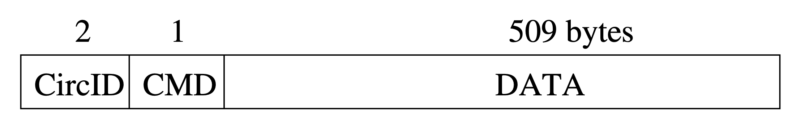
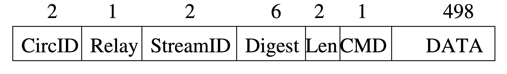
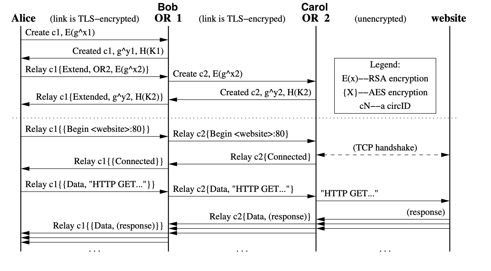
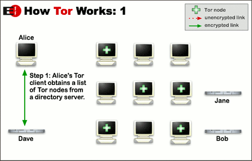
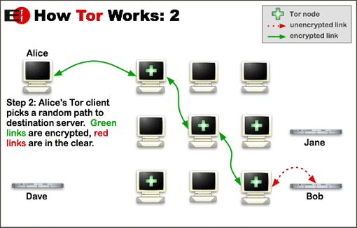
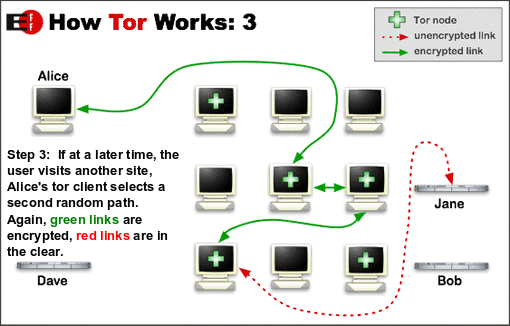

## Qu'est-ce que TOR?

Tor (pour « The Onion Router ») est un réseau informatique superposé mondial décentralisé, dont le but initial est d’assurer une sécurité plus importante que le réseau internet classique.

Le principe fondamental du réseau Tor est de faire transiter les données des utilisateurs sur un réseau distribué géré par des volontaires dans le monde entier, empêchant (du moins, rendant plus difficile) les gouvernements, fournisseurs d’accès à internet ou certains pirates d’être informés des sites visités par les utilisateurs.\
Pour ce faire, Tor utilise le « routage oignon », qui consiste à acheminer le trafic à travers plusieurs serveurs, et de le chiffrer à chaque étape.

Le réseau Tor possède son propre navigateur, Tor browser qui est basé sur Firefox et constitue le moyen le plus aisé et le plus répandu d’accéder au réseau.

## Un peu d'histoire

En 1995, préoccupés par le manque de sécurité sur internet, et la facilité avec laquelle les utilisateurs pouvaient être suivis et surveillés, Mike Reed, David Goldschlag et Paul Syverson du laboratoire de recherche naval américain (NRL), étudient un moyen de créer un réseau palliant ces problèmes, et déploient de premiers prototypes de « routage oignon ».

Au début des années 2000, Roger Dingledine, diplômé du MIT, commence à travailler aux côtés de Paul Syverson sur un projet de routage en oignon du NRL. Nick Mathewson, un camarade de classe de Dingledine au MIT, les rejoint rapidement.

<figure data-size="small">

Roger Dingledine en 2013

</figure>

Le réseau est déployé en octobre 2002, et son code publié sous une licence de logiciel libre. Fin 2003, le réseau comptait plus d’une dizaine de noeuds volontaires, principalement aux États-Unis.

En 2004, l’EFF (Electronic Frontier Foundation) commence à financer le projet, ce qui mène en 2006 à la création du Tor Project Inc, une organisation à but non lucratif, dont le but est de maintenir le développement du réseau.

Réalisant la difficulté pour les utilisateurs lambda à accéder au réseau, l’organisation lance en 2008 le développement de Tor Browser, le navigateur officiel du réseau.

Depuis, Tor est considérablement utilisé, notamment par des activistes dont les prises de position sont illégales dans certains pays autoritaires, mais également parfois pour des activités illicites (trafic de drogue, d’armes, pédopornographie, etc.).

## Le fonctionnement du réseau TOR

Comme indiqué précédemment, le réseau Tor est composé de milliers de noeuds bénévoles (environ 6500 en avril 2021), dont le but est de faire transiter et chiffrer l’information d’une partie à l’autre du réseau. Ces noeuds, également appelés routers, communiquent entre eux via des connexions TLS utilisant des clés éphémères, ces dernières permettant de s’assurer que les données restent intègres et confidentielles. Les données transitent d’un client vers un serveur en empruntant un circuit créé par « l’onion proxy » du client, généralement le navigateur Tor.\
Étudions le processus de transit de l’information plus en détail.

### Les cellules

Les cellules sont les unités de communication du réseau Tor. Chaque cellule a une taille de 512 octets, et est constituée d’un header (en-tête) et d’une payload (charge utile). Le header comprend en premier lieu un « circuit identifier » spécifiant le circuit auquel la cellule fait référence. Il permet de différencier les circuits, ces derniers pouvant être multiplexés sur une seule connexion TLS. Le header comporte également une commande, indiquant l’action à effectuer à partir de la payload.\
Selon cette commande, une cellule est une cellule de contrôle, qui est interprétée par le noeud qui la reçoit, ou une cellule relai, permettant de faire transiter la donnée.

Les commandes des cellules de contrôle sont :\
-Padding, utilisée principalement pour le keepalive (s’assurer que le lien entre deux noeuds est actif, et empêcher que ce lien soit rompu).\
-Create, pour créer un nouveau circuit.\
-Destroy, pour supprimer un circuit.

<figure>

En-tête d’une cellule de contrôle

</figure>

Les cellules relais ont toutes une commande « Relay ».

En outre, les cellules relais ont un en-tête supplémentaire contenant :\
-Un identifiant de stream, ces derniers pouvant être multiplexés sur un même circuit.\
-Un checksum, pour s’assurer de l’intégrité de la payload.\
-La taille de la payload.\
-Une commande supplémentaire.

Cette commande supplémentaire peut être :\
-_Relay data_, pour les données qui circulent dans le flux.\
-_Relay begin_, pour ouvrir un stream.\
-_Relay end_, pour fermer un stream.\
-_Relay teardown_, pour fermer un stream cassé.\
-_Relay connected_, pour notifier l’onion proxy que le relai a commencé.\
-_Relay extend/extended_, pour étendre le circuit et accuser réception (acknowledge).\
-_Relay truncate_, pour fermer une partie du circuit et accuser réception.\
-_Relay sendme_, utilisé pour le contrôle des embouteillages sur un noeud.\
-_Relay drop_, utilisé pour implémenter des communications de tests à longue portée.

<figure>

En-tête d’une cellule relai

</figure>

Les en-têtes et payloads des cellules relais sont chiffrés et déchiffrés lorsque la cellule relai se déplace le long du circuit, en utilisant un chiffrement AES 128-bit.

### Les circuits

Les proxys onion créent un circuit pour tous les flux TCP. Ainsi, si le navigateur TOR d’un utilisateur ouvre plusieurs pages web, ces dernières utiliseront le même circuit. Ce circuit est réinitialisé fréquemment pour garantir une sécurité optimale, et en arrière-plan, pour éviter de nuire à l’expérience utilisateur.

Les circuits sont créés de manière incrémentielle, c’est-à-dire en négociant une clé avec chaque noeud du circuit, un « saut » à la fois.\
Supposons qu’Alice souhaite créer un nouveau circuit, dont elle a choisi les noeuds.\
Alice envoie tout d’abord une cellule de type « create » au premier noeud sur son chemin, appelé Bob, et choisit un « circID » (pour rappel, identifiant de circuit) non utilisé.\
La payload de la cellule permet de mettre en place le chiffrage symétrique via l’algorithme de Diffie-Hellman. Elle contient ainsi un nombre premier nommé _g_, élevé à une puissance _x_, choisie au hasard. Bob envoie alors le même nombre _g_, cette fois élevé à la puissance _y_, également choisie aléatoirement. Pour rappel du fonctionnement de l’algorithme de Diffie-Hellman, Alice et Bob ont désormais _g x_ ainsi que _g y_, et peuvent ainsi calculer _K = g xy_, et utiliser ce nombre pour chiffrer leur communication.

Pour étendre le circuit, Alice envoie une cellule relai de type « extend » à Bob, en spécifiant l’adresse du noeud qu’elle veut ajouter au circuit, appelé ici Carol, et ajoute à la payload de la cellule _g x2_, avec _x2_ choisi aléatoirement, qui, comme avec Bob permettra de calculer une clé _K1_, permettant le chiffrement des échanges.\
Bob reçoit une cellule relai de type « extend ». Comme il est le dernier noeud du circuit, il crée une cellule de type « create » ayant toujours _g x2_ pour payload, et l’envoie à Carol. Comme Alice précédemment, Bob choisit un nouveau _circID_.\
Lorsque Carol reçoit la cellule, elle renvoie à Bob _g y2_, qui renvoie ce nombre à Alice via une cellule relai de type « extended ». Alice et Carol peuvent alors calculer _K2 = g x2y2_, et ainsi communiquer en chiffrant leurs données avec cette clé.\
On peut remarquer que le processus est très similaire au premier, lors de la création d’un chemin entre Alice et Bob.\
Le schéma ci-dessous résume le processus de création de circuit et présente une communication TCP basique avec un site internet.

<figure>

Création de circuits et communication avec une page web

</figure>

Alice partage désormais une clé avec chacun de noeuds relais sur le circuit.\
Supposons qu’Alice souhaite, par exemple, envoyer une requête HTTP à un site web. Le circuit est composé de deux noeuds relais, Bob et Carol. Après avoir créé la requête HTTP, Alice va la chiffrer, d’abord avec la clé _K2_ , partagée avec Carol, puis avec la clé _K_, partagée avec Bob, puis envoyer cette requête via une cellule relai.\
Lors de la réception de la cellule, Bob va la déchiffrer grâce à la clé _K_, puis l’envoyer à Carol. La cellule reste toujours chiffrée avec la clé _K2_ . À l’instar de Bob, Carol va déchiffrer la cellule à sa réception, cette fois avec la clé _K2_ , puis l’envoyer au site web demandé par Alice. Carol va chiffrer la réponse de la part du site web avec la clé _K2_ , après avoir mis cette réponse dans une nouvelle cellule, puis l’envoyer à Bob, qui va à son tour la chiffrer avec la clé _K_.\
À la réception de la cellule, Alice n’aura plus qu’à la déchiffrer avec les clés _K_ et _K2_ pour obtenir la réponse du site web en clair.

### La gestion d'erreurs

Une cellule pouvant être altérée lors de son transport, il est nécessaire de gérer des cas d’erreurs.\
Lors de la réception d’une cellule, un noeud vérifie son intégrité grâce à son hash (en pratique, les noeuds vérifient seulement que les deux premiers bytes de la vérification d’intégrité sont zéro). Si la cellule est invalide, le noeud remplace le _circID_ (identifiant de circuit) de la cellule par celui correspondant au noeud suivant sur le chemin, et envoie la cellule au noeud suivant. Si le dernier noeud du circuit reçoit une cellule invalide, le circuit est détruit.\
Pour détruire le circuit, le proxy (Alice dans l’exemple de la section précédente) envoie une cellule de contrôle de type « destroy ». Chaque noeud sur le chemin ferme alors les flux sur ce circuit et envoie une cellule « destroy » au noeud suivant sur le chemin.

### L’ouverture et la fermeture de streams

Lorsque l’onion proxy souhaite établir une connexion TCP à une adresse et un port donnés, il sélectionne le circuit le plus récemment créé, ou en crée un s’il n’y en a aucun. Il choisit ensuite le noeud de sortie sur le circuit, qui sera la plupart du temps le dernier noeud du circuit. Le proxy ouvre le stream en envoyant une cellule relai de type « begin » au noeud de sortie, en créant un nouveau _streamID_. Une fois connecté à l’hôte distant, le noeud de sortie envoie à l’onion proxy une cellule relai de type « connected ».\
Lorsque le stream doit être fermé, le proxy utilise un « two-step handshake ». Si une erreur survient lors de la fermeture de stream, le noeud où l’erreur est survenue envoie une cellule relai de type « teardown cell » à la cellule suivante. Sinon, il envoie une cellule relai de type « end ».

### Pour résumer

Alice récupère d'abord une liste de noeuds grâce à un « directory server » du réseau Tor. Sur le schéma ci-dessous, les noeuds sélectionnés sont marqués par une croix verte.

<figure>

</figure>

Lorsqu’elle veut établir une connexion à un serveur, elle choisit un chemin aléatoire pour accéder à ce serveur. La connexion passera par tous ces noeuds, chacun apportant une couche de chiffrage supplémentaire.

<figure>

</figure>

Après environ 10 minutes, Alice génère un nouveau chemin.

<figure>

</figure>
